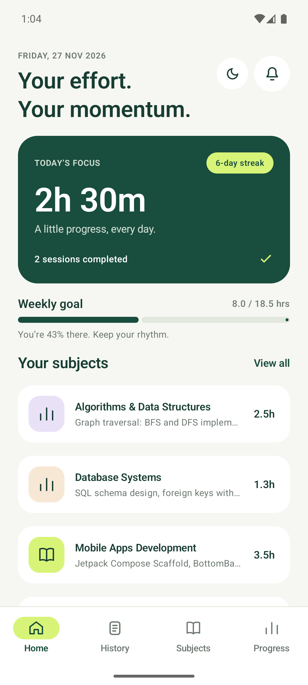
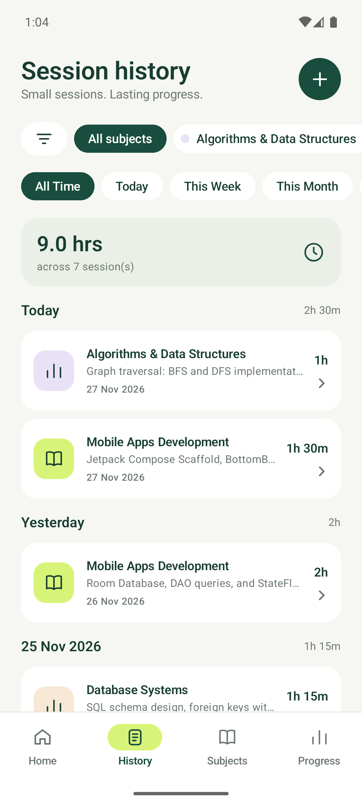
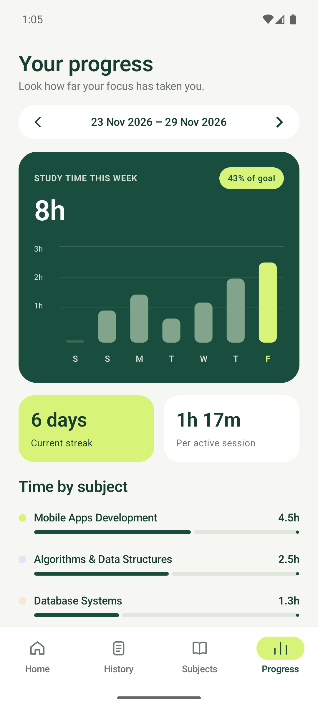
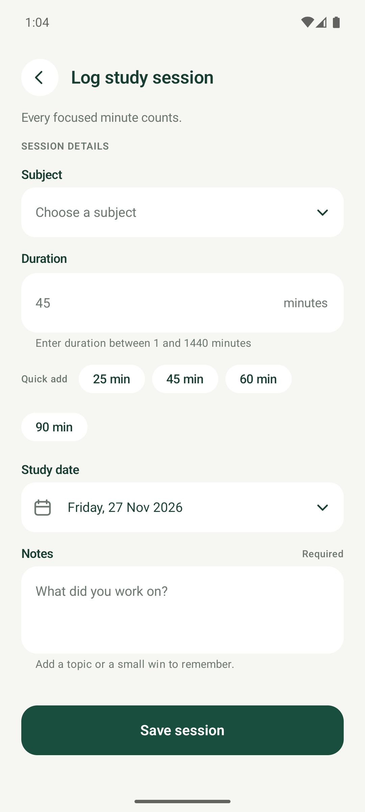
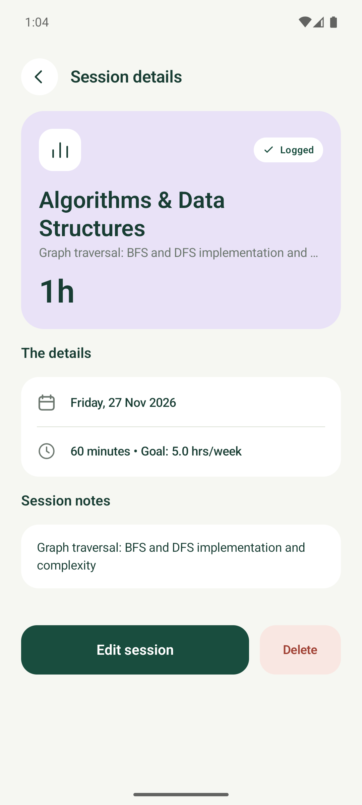
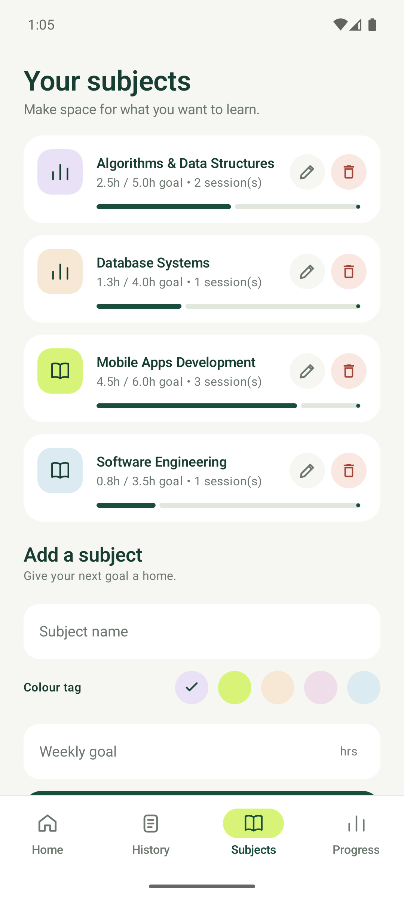
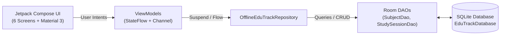

<div align="center">

# EduTrack — Study Progress Tracker

**A modern offline-first Android study planner, session logger, and progress analytics app built with Kotlin, Jetpack Compose, Material 3, and Room.**

[](https://github.com/Zaman-Rahim/EduTrack/actions/workflows/android-apk.yml)


<br />

### 📲 Download Latest Test Build on Android

[](https://github.com/Zaman-Rahim/EduTrack/releases/latest/download/EduTrack-debug.apk)
&nbsp;
[](https://github.com/Zaman-Rahim/EduTrack/releases/latest)

*Tap **Download EduTrack-debug.apk** directly from your Android phone's browser to install and test the latest build.*

</div>

---

## ✨ Overview

**EduTrack** helps students build consistent study habits by organizing courses with weekly hour targets, logging focused study sessions with notes, calculating consecutive daily streaks, and visualizing weekly momentum through custom Jetpack Compose charts.

Every screen, icon, pastel palette, and interactive component in EduTrack was designed in **Figma** and faithfully translated into **Jetpack Compose + Material 3**, backed by a reactive **Room (SQLite)** offline-first architecture.

---

## 📱 App Screenshots

<table>
  <tr>
    <td align="center"><strong>Home Dashboard</strong></td>
    <td align="center"><strong>Session History</strong></td>
    <td align="center"><strong>Progress & Analytics</strong></td>
  </tr>
  <tr>
    <td></td>
    <td></td>
    <td></td>
  </tr>
  <tr>
    <td align="center"><strong>Log Study Session</strong></td>
    <td align="center"><strong>Session Details</strong></td>
    <td align="center"><strong>Subject Manager</strong></td>
  </tr>
  <tr>
    <td></td>
    <td></td>
    <td></td>
  </tr>
</table>

---

## 🚀 Key Features

- **Focused Daily Dashboard (`HomeScreen`):**
  - Displays today's accumulated study duration, active consecutive **study streak** pill, and animated weekly goal progress meter.
  - Lists active subjects with pastel icon badges and weekly progress summaries, plus one-tap quick logging.
- **Session Logger & Editor (`AddEditSessionScreen`):**
  - Full input validation preventing empty fields, invalid numeric durations (`1–1440` min), or missing notes.
  - Quick-add duration chips (`25 min`, `45 min`, `60 min`) and Material 3 `DatePickerDialog` integration.
- **Searchable History & Filtering (`HistoryScreen`):**
  - Real-time search across notes and subjects, paired with subject chips and date-range presets (`All Time`, `Today`, `This Week`, `This Month`, and `Custom` `DateRangePicker`).
  - Groups sessions chronologically (`Today`, `Yesterday`, and earlier dates) with daily totals.
- **Session Details & Management (`SessionDetailScreen`):**
  - Full session reflection view with pastel subject hero card, metadata breakdown, edit navigation, and confirmation-guarded deletion.
- **Subject Manager (`SubjectManagerScreen`):**
  - Full Room CRUD for courses with curated pastel color tags, weekly hour targets, duplicate-name protection, and cascade-safe deletion.
- **Custom Canvas Analytics (`StatsScreen` & `StudyBarChart`):**
  - Custom Jetpack Compose `Canvas` 7-day bar chart with `1h / 2h / 3h` gridlines, current streak card, per-session averages, and per-subject goal tracking.
- **Dynamic Light & Dark Theme:**
  - In-app Light/Dark mode switching with synchronized edge-to-edge system status and navigation bars.

---

## 🏗️ Architecture & Tech Stack

EduTrack follows **Clean MVVM Architecture** with unidirectional data flow (`StateFlow` for UI state and `Channel` for one-shot Snackbar/navigation events):



| Layer | Technology |
| :--- | :--- |
| **Language** | Kotlin `2.1.0` |
| **UI Toolkit** | Jetpack Compose + Material 3 + Custom `Canvas` Charts |
| **Navigation** | Navigation Compose (`NavController` & `NavHost` with typed route args) |
| **Architecture** | MVVM (`ViewModel`, `StateFlow`, `Channel`, `AppViewModelFactory`) |
| **Persistence** | Room `2.6.1` (KSP) — `SubjectEntity` & `StudySessionEntity` (`CASCADE` Foreign Key) |
| **Async** | Kotlin Coroutines & Flow |
| **Testing** | JUnit 4 unit tests (`DateTimeUtilsTest`, `ValidationUtilsTest`, `EduTrackRepositoryTest`) |
| **CI/CD** | GitHub Actions auto-test, APK build & Rolling Release publishing |

---

## 🎨 Design System

Crafted directly from Figma using custom SVG vector drawables (`res/drawable/ic_figma_*.xml`) and a cohesive academic color palette:

| Token | Hex | Usage |
| :--- | :--- | :--- |
| `ForestGreenPrimary` | `#194D3E` | Focus hero card, weekly chart card, primary CTAs, progress bars |
| `LimeAccent` | `#D8F478` | Streak pills, active bottom nav pill indicator, highlighted chart bar |
| `LinenBackground` | `#F6F7F2` | Soft off-white light theme scaffold canvas |
| `ForestGreenDark` | `#183D33` | High-contrast primary typography & active icons |
| `Pastel Subject Swatches` | `#E9E2F7`, `#D8F478`, `#F7E8D5`, `#F0DDEA`, `#DCEBF2` | Subject card badges & detail hero headers |

---

## ⚙️ Automated CI/CD (GitHub Actions)

Every push to `main` or `master` runs [`.github/workflows/android-apk.yml`](.github/workflows/android-apk.yml):
1. Runs all unit tests (`./gradlew testDebugUnitTest`).
2. Builds an installable Debug APK (`./gradlew assembleDebug`).
3. Uploads the versioned APK build as a **GitHub Actions Artifact** (retained 30 days).
4. Automatically updates the **`latest-apk`** GitHub Release with `EduTrack-debug.apk` for direct 1-click download onto any Android device.

---

## 🛠️ Local Development Setup

### Prerequisites
- **Android Studio** (Ladybug or newer) with **JDK 17**
- **Android SDK** (`compileSdk 35`, `minSdk 26`)

### Run Locally
```bash
git clone https://github.com/Zaman-Rahim/EduTrack.git
cd EduTrack
./gradlew testDebugUnitTest assembleDebug
```

### Push New Features (Triggers Auto-APK Build)
```bash
git add .
git commit -m "Describe your new feature"
git push
```
Wait ~2–3 minutes for GitHub Actions to finish, then download the updated **`EduTrack-debug.apk`** from the [Releases](https://github.com/Zaman-Rahim/EduTrack/releases) page on your phone!
