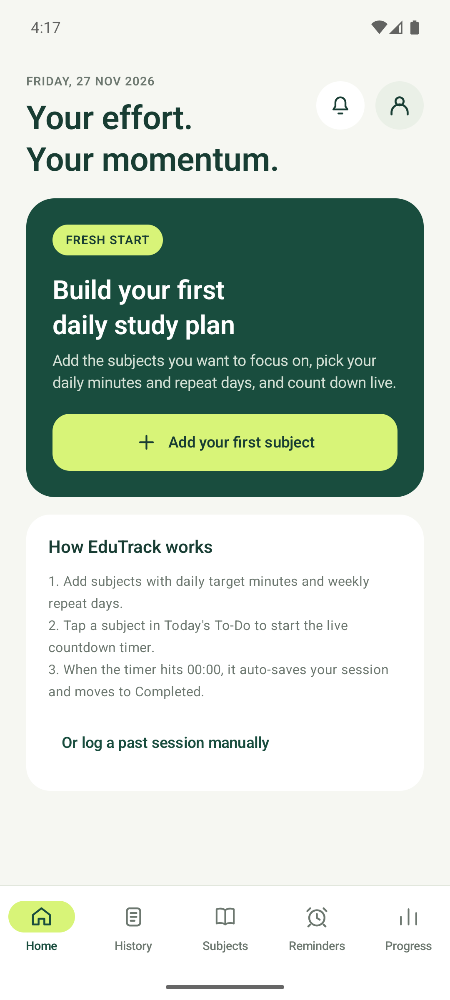
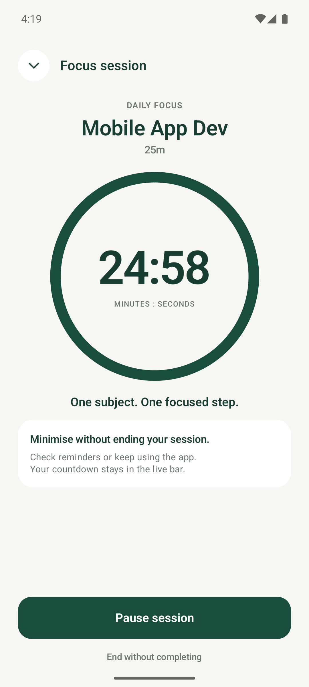
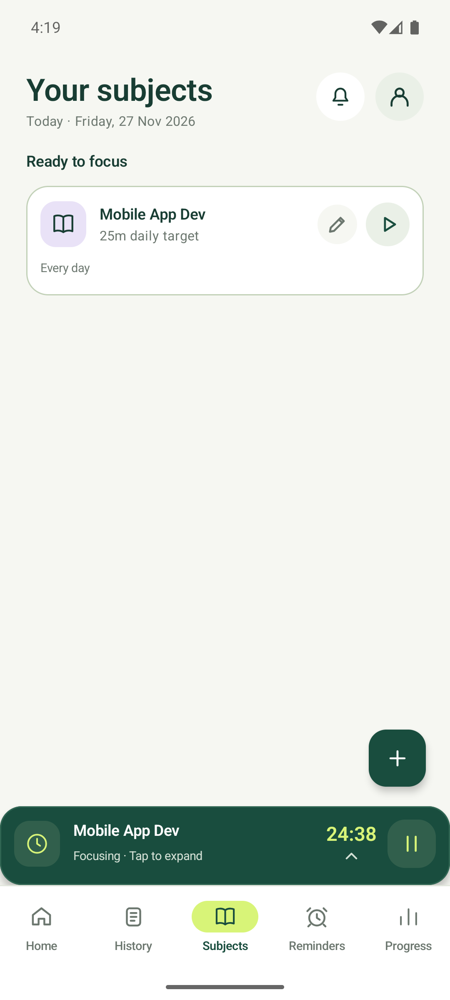
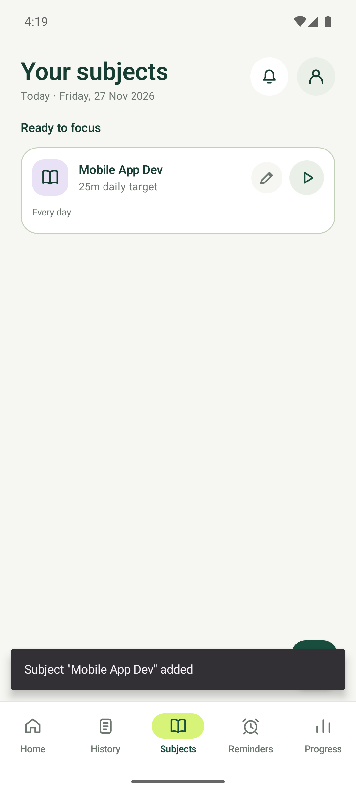
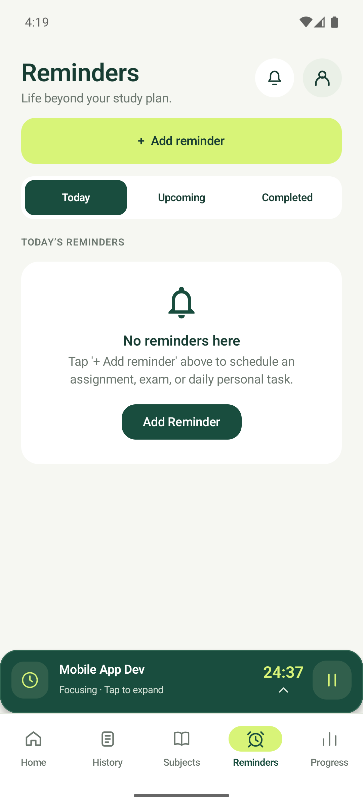
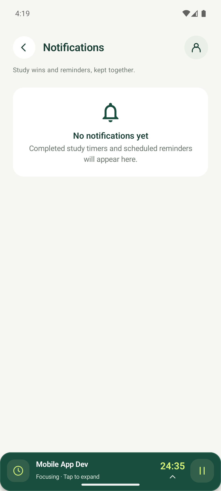
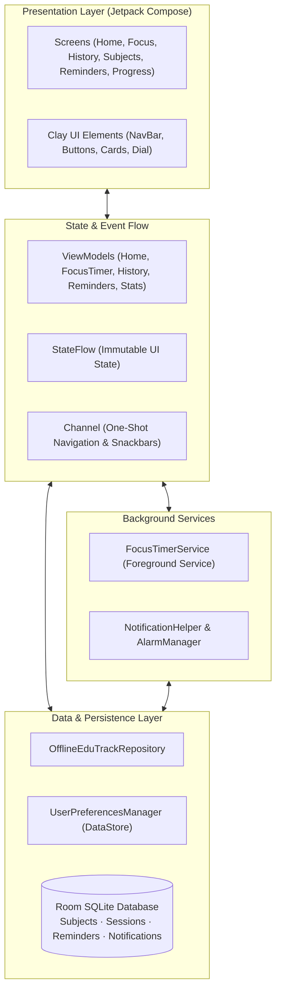

<div align="center">

# EduTrack — Intelligent Study & Focus Companion

**An ultra-fluid, 120Hz offline-first Android study planner, live focus timer, and academic analytics app built with Kotlin, Jetpack Compose, Material 3, and Room.**

[](https://github.com/Zaman-Rahim/EduTrack/actions/workflows/android-apk.yml)


<br />

### 📲 Download Latest Build on Android

[](https://github.com/Zaman-Rahim/EduTrack/releases/latest/download/EduTrack-debug.apk)
&nbsp;
[](https://github.com/Zaman-Rahim/EduTrack/releases/latest)

*Tap **Download EduTrack-debug.apk** directly from your Android browser to install or update the app without losing your study data.*

</div>

---

## ✨ What's New in EduTrack 2.0

EduTrack 2.0 is a complete reimagining based on the Figma design system, rebuilt from the ground up for tactile physical feedback, silky 120Hz animations, and a laser-focused study workflow:

- ⏱️ **Live Focus Timer & Background Service:**
  - Foreground service with notification controls to keep countdowns alive when minimized.
  - Interactive **Live Focus Bar** floating above navigation with live countdown and one-tap controls.
  - Fluid vertical modal presentation with smooth deceleration curves.
  - **Multi-Subject Guard:** Prevents overlapping sessions and seamlessly prompts users to switch or pause.
  - **Auto-completion screen:** Instantly surfaces the celebration & completion view when the timer reaches `00:00` with ringtone chime.
- 🎨 **Figma Clay UI System:**
  - Custom `ClayButton`, `ClayCard`, and `ClayBottomNavBar` with subtle inner shadows, 3D pill elevation, and spring bounce physics.
  - 100% custom SVG vector drawables replaced heavy icon bundles, slashing APK size down to **1.6 MB**.
- 🚀 **120Hz Ultra-Fluid Frame Pacing:**
  - Zero-recomposition `ModifierNodeElement` click effects (`BounceScaleElement`).
  - Pre-allocated draw paths and hardware-accelerated Canvas render passes.
  - R8 Full-Mode minification and dead-code stripping.
- 🔔 **Reminders & Exact Alarms:**
  - Schedule course reminders with repeat patterns (Daily, Weekdays, Custom days).
  - Exact alarms using Android `AlarmManager` with high-priority full-screen intent compatibility.
- 📥 **In-App Notification Center:**
  - Notification inbox for study milestones, completed sessions, and reminders.
- 📊 **Custom Canvas Analytics:**
  - Dynamic 7-day study bar chart with target gridlines, streak tracking, and per-subject weekly goal progress.
- 🧭 **Intuitive Back Navigation:**
  - Pressing system back on secondary tabs (History, Subjects, Reminders, Progress) automatically returns to Home before exiting.

---

## 📱 Visual Showcase

<table>
  <tr>
    <td align="center"><strong>Welcome Home</strong></td>
    <td align="center"><strong>Focus Session</strong></td>
    <td align="center"><strong>Live Focus Bar</strong></td>
  </tr>
  <tr>
    <td></td>
    <td></td>
    <td></td>
  </tr>
  <tr>
    <td align="center"><strong>Subject Schedule</strong></td>
    <td align="center"><strong>Reminders</strong></td>
    <td align="center"><strong>Notification Center</strong></td>
  </tr>
  <tr>
    <td></td>
    <td></td>
    <td></td>
  </tr>
</table>

---

## 🏗️ Architecture & Technology Stack

EduTrack follows **Clean Modern Android Architecture (MVVM)** with Unidirectional Data Flow (UDF):



| Layer | Technologies & Libraries |
| :--- | :--- |
| **Language** | Kotlin `2.1.0` |
| **UI Toolkit** | Jetpack Compose + Material 3 + Custom Canvas Graphics |
| **State Management** | Android ViewModel, Kotlin Coroutines, `StateFlow`, `Channel` |
| **Persistence** | Room `2.6.1` with KSP (`SubjectEntity`, `StudySessionEntity`, `ReminderEntity`, `NotificationEntity`) |
| **Background Work** | Foreground Service with WakeLocks, Android `AlarmManager` with Exact Scheduling |
| **Preferences** | AndroidX DataStore Preferences |
| **Navigation** | Navigation Compose with horizontal slide transitions & vertical sheet overlays |
| **Build Optimization** | R8 Full-Mode, Resource Shrinking, Proguard Optimization (**1.6 MB Release APK**) |
| **Testing** | JUnit 4 unit tests (`EduTrackRepositoryTest`, `DateTimeUtilsTest`, `ValidationUtilsTest`, `HomeMessageEngineTest`) |
| **CI/CD** | GitHub Actions Automated Test & Rolling Release Publisher |

---

## 🎨 Design Tokens & Palette

Strictly mapped from Figma design components:

| Token Name | Light Value | Dark Value | Purpose |
| :--- | :--- | :--- | :--- |
| `ForestGreenPrimary` | `#194D3E` | `#194D3E` | Hero cards, primary action buttons, active timer progress |
| `LimeAccent` | `#D8F478` | `#D8F478` | Highlight badges, active tab indicator, streak pills |
| `ForestGreenDark` | `#183D33` | `#183D33` | High-contrast headers and primary labels |
| `LinenBackground` | `#F6F7F2` | `#121614` | Edge-to-edge scaffold canvas |
| `ClaySurface` | `#FFFFFF` | `#1E2522` | Tactile card surfaces |
| `ClayShadow` | `rgba(0,0,0,0.06)` | `rgba(0,0,0,0.30)` | Clay bottom elevation |

---

## ⚙️ Automated CI/CD (GitHub Actions)

Every push to `main` triggers [`.github/workflows/android-apk.yml`](.github/workflows/android-apk.yml):
1. **Unit Tests:** Executes `./gradlew testDebugUnitTest` across all test suites.
2. **Release Compilation:** Builds `./gradlew assembleRelease` using R8 full-mode optimization.
3. **Artifact Archiving:** Uploads versioned APKs as 30-day workflow artifacts.
4. **Instant Release Deployment:** Deploys `EduTrack-debug.apk` directly to the [GitHub Releases](https://github.com/Zaman-Rahim/EduTrack/releases) page for one-click installation on mobile devices.

---

## 🛠️ Building & Running Locally

### Requirements
- **Android Studio** Ladybug (2024.2.1+) or newer
- **JDK 17** (Temurin or OpenJDK)
- Android SDK with `minSdk 26`, `compileSdk 35`

### Clone & Build
```bash
# Clone the repository
git clone https://github.com/Zaman-Rahim/EduTrack.git
cd EduTrack

# Run unit test suite
./gradlew testDebugUnitTest

# Assemble production-optimized release APK (1.6 MB)
./gradlew assembleRelease

# The APK will be available at:
# app/build/outputs/apk/release/app-release.apk
```

---

## 📄 License
This project is licensed under the [MIT License](LICENSE).
